# テーマ2：HTML・CSSの基本とWebページ公開

[← 概要](../README.md) ｜ [← テーマ1](../theme1/README.md)

課題20〜29の作業内容と証跡をまとめます．

- **公開URL：** https://generalliebe.github.io/FriWorkshop/
- ソースコード：[`docs/`](../docs/)（GitHub Pagesで公開するフォルダ）
  - [`docs/minimal/index.html`](../docs/minimal/index.html)：課題20の最小ページ
  - [`docs/index.html`](../docs/index.html)：課題21〜28の自己紹介ページ
  - [`docs/style.css`](../docs/style.css)：外部CSS
  - [`docs/images/avatar.svg`](../docs/images/avatar.svg)：自作のアイコン画像
- スクリーンショット：[`evidence/theme2/`](../evidence/theme2/)（Chrome 〈ヘッドレスモード〉で撮影）
- 自己紹介・時間割の内容は見本です．

| 課題 | 内容 | 状態 |
|---|---|---|
| 20 | 最小限のHTMLページ | ✅ |
| 21 | 自己紹介ページ（複数のHTML要素） | ✅ |
| 22 | 外部CSSとCSS変数による装飾 | ✅ |
| 23 | レスポンシブ対応 | ✅ |
| 24 | 入力フォーム | ✅ |
| 25 | テーブル | ✅ |
| 26 | レイアウト（Grid＋Flexbox） | ✅ |
| 27 | セマンティックHTMLとLighthouse | ✅ |
| 28 | CSSアニメーション | ✅ |
| 29 | GitHub Pagesで公開 | ✅ |

---

## 20. 最小限のHTMLページ

[`docs/minimal/index.html`](../docs/minimal/index.html)（公開URL：https://generalliebe.github.io/FriWorkshop/minimal/ ）

```html
<!DOCTYPE html>
<html lang="ja">
<head>
  <meta charset="UTF-8">
  <meta name="viewport" content="width=device-width, initial-scale=1">
  <title>はじめてのWebページ</title>
</head>
<body>
  <h1>はじめてのWebページ</h1>
  <p>これはFriWorkshopのテーマ2で作成した，最小限のHTMLページです．</p>
</body>
</html>
```

| 記述 | 役割 |
|---|---|
| `<!DOCTYPE html>` | HTML5の文書であることを宣言する．これがないとブラウザが古い互換モード（Quirksモード）で表示する． |
| `<html lang="ja">` | ページの言語が日本語であることを示す．読み上げソフトの発音や翻訳機能が正しく働く． |
| `<meta charset="UTF-8">` | 文字コードの指定．ないと日本語が文字化けすることがある． |
| `<meta name="viewport" ...>` | スマートフォンで画面幅に合わせて表示させる．ないとPC用の幅で縮小表示される． |
| `<title>` | ブラウザのタブや検索結果に表示されるページ名． |

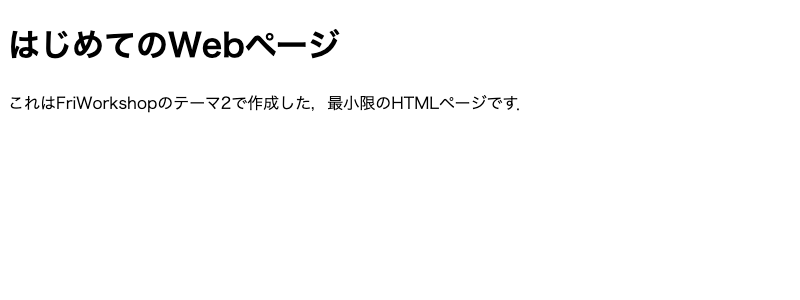

---

## 21. 複数のHTML要素を用いた自己紹介ページ

ソース全体：[`docs/index.html`](../docs/index.html)．自己紹介部分を抜粋：

```html
<section id="profile" class="card">
  <h1>自己紹介</h1>
  <div class="profile">
    
    <p>
      はじめまして，generalLiebeです．九州大学でWebサービス開発を学んでいます．
      このページはFriWorkshopのテーマ2「HTML・CSSの基本とWebページ公開」の課題として作成しました．
    </p>
  </div>

  <h2>好きなこと</h2>
  <ul>
    <li>プログラミング（最近はWebの仕組みを勉強中）</li>
    <li>読書</li>
    <li>散歩</li>
  </ul>

  <h2>リンク</h2>
  <ul>
    <li><a href="https://www.kyushu-u.ac.jp/" target="_blank" rel="noopener">九州大学のWebサイト</a></li>
    <li><a href="https://github.com/generalLiebe/FriWorkshop" target="_blank" rel="noopener">このページのリポジトリ（GitHub）</a></li>
  </ul>
</section>
```

- `<h1>`（ページの大見出しは1つだけ）→`<h2>`（小見出し）の順で見出しの階層を作った．
- 外部サイト（九州大学）へのリンクを `<a href="...">` で設置．`target="_blank"` で新しいタブで開き，`rel="noopener"` で開いた先のページから元のページを操作されないようにしている．
- 画像はSVGで自作したアイコン．`alt` 属性に画像の内容を書いたので，画像が表示できないときや読み上げソフトでも内容が伝わる．`width`/`height` を書くと読み込み中にレイアウトがずれない．

**表示結果（CSSを読み込む前の状態）**

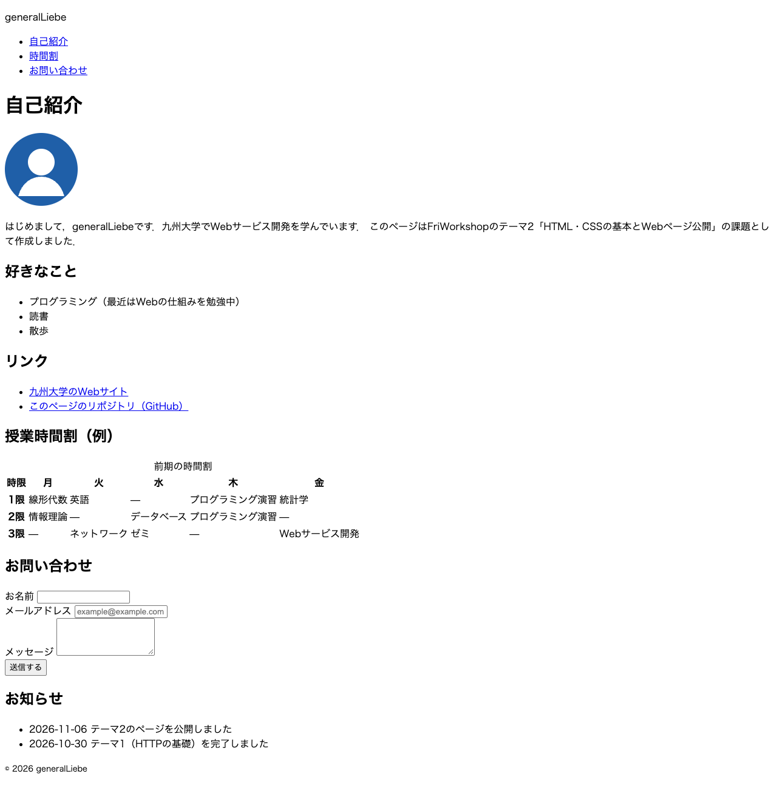

---

## 22. 外部CSSファイルによる装飾

`<head>` で外部CSSを読み込む：

```html
<link rel="stylesheet" href="style.css">
```

[`docs/style.css`](../docs/style.css) の冒頭で，色・フォント・サイズ・余白を**CSS変数（カスタムプロパティ）**として定義し，以降は `var(--名前)` で参照している．

```css
/* ===== CSS変数（色・サイズ） ===== */
:root {
  --main-color: #1f5fa8;
  --main-color-dark: #154479;
  --accent-color: #f2b705;
  --bg-color: #f4f6f9;
  --card-color: #ffffff;
  --text-color: #222222;
  --text-sub-color: #595959; /* 改善前は #9a9a9a（コントラスト不足） */
  --border-color: #d9dee5;

  --font-base: "Hiragino Sans", "Noto Sans JP", "Yu Gothic", sans-serif;
  --font-size-base: 16px;
  --font-size-h1: 2rem;
  --font-size-h2: 1.4rem;

  --space-s: 8px;
  --space-m: 16px;
  --space-l: 32px;
  --radius: 12px;
  --max-width: 1080px;
}

body {
  margin: 0;
  font-family: var(--font-base);
  font-size: var(--font-size-base);
  line-height: 1.8;
  color: var(--text-color);
  background-color: var(--bg-color);
}

h1 {
  font-size: var(--font-size-h1);
  margin: 0 0 var(--space-m);
  border-bottom: 4px solid var(--accent-color);
  padding-bottom: var(--space-s);
}

.card {
  background-color: var(--card-color);
  border: 1px solid var(--border-color);
  border-radius: var(--radius);
  padding: var(--space-l);
}
```

（全体は [`docs/style.css`](../docs/style.css) を参照）

**CSS変数を使う利点：** テーマカラーを変えたいときは `:root` の1か所を書き換えるだけで，見出し・ボタン・表の見出し行などすべてに反映される．課題23では，スマートフォン幅のときだけ変数の値を上書きして文字サイズや余白をまとめて切り替えている．

**装飾後**

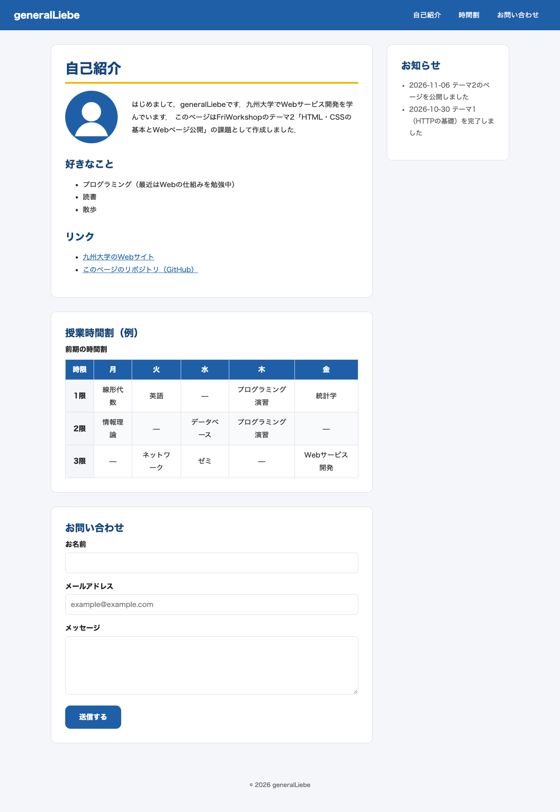

---

## 23. レスポンシブ対応

画面幅が **600px以下** のときに適用されるメディアクエリ：

```css
/* ===== レスポンシブ（スマートフォン幅：600px以下） ===== */
@media (max-width: 600px) {
  :root {
    --font-size-base: 15px;
    --font-size-h1: 1.6rem;
    --font-size-h2: 1.2rem;
    --space-l: 20px;
  }

  /* ヘッダー：タイトルとメニューを縦に並べる */
  .site-header {
    flex-direction: column;
    align-items: flex-start;
    padding: var(--space-m);
  }

  /* 2カラム → 1カラム（サイドバーは本文の下へ） */
  .layout {
    grid-template-columns: minmax(0, 1fr);
    grid-template-areas:
      "main"
      "sidebar";
  }

  .sidebar {
    position: static;
  }

  /* アイコンと文章を縦に並べる */
  .profile {
    flex-direction: column;
    text-align: center;
  }

  .button {
    width: 100%;
  }
}
```

| | PC幅（1280px） | スマートフォン幅（375px） |
|---|---|---|
| レイアウト | 本文＋右サイドバーの2カラム | 1カラム（お知らせは一番下） |
| ヘッダー | タイトル左・メニュー右の横並び | タイトルの下にメニュー |
| 文字サイズ | 本文16px，h1 2rem | 本文15px，h1 1.6rem |
| 自己紹介 | アイコンと文章が横並び | アイコンの下に文章（中央寄せ） |
| 送信ボタン | 文字幅 | 横幅いっぱい（指で押しやすい） |
| 時間割 | 全体を表示 | 表の部分だけ横スクロール |

**つまずいた点：** 最初はスマートフォン幅で時間割の表（`min-width: 520px`）に引っ張られてページ全体が画面幅よりも広くなり，ヘッダーが途中で切れてしまった．Gridの列 `1fr` は「中身の最小幅より小さくならない」ため，`minmax(0, 1fr)` に変えて列が中身より狭くなれるようにしたところ，表の部分（`overflow-x: auto` を付けた `.table-wrap`）だけが横スクロールするようになった．

**表示確認：** Chromeのデベロッパーツールの「デバイスツールバー」（`⌘⇧M`）でiPhone相当（375px）とPC幅を切り替えて確認できる．以下は同じ幅で撮影したもの．

| スマートフォン幅（375px） | PC幅（1280px） |
|---|---|
| 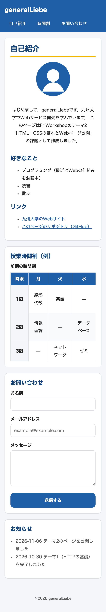 | 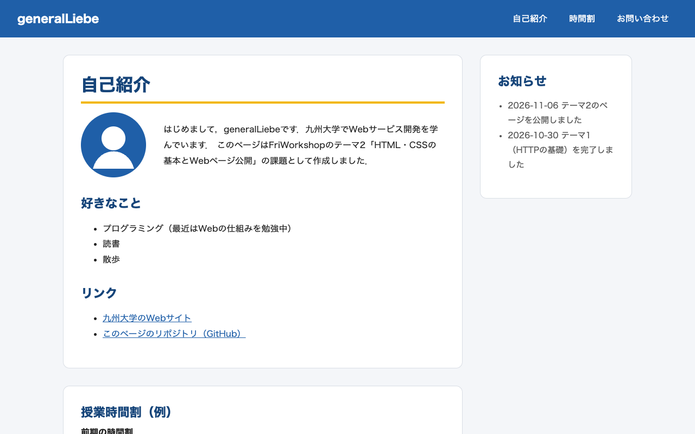 |

---

## 24. 入力フォーム

```html
<section id="contact" class="card">
  <h2>お問い合わせ</h2>
  <form class="contact-form" action="#" method="post">
    <div class="field">
      <label for="name">お名前</label>
      <input type="text" id="name" name="name" autocomplete="name" required>
    </div>
    <div class="field">
      <label for="email">メールアドレス</label>
      <input type="email" id="email" name="email" autocomplete="email" placeholder="example@example.com" required>
    </div>
    <div class="field">
      <label for="message">メッセージ</label>
      <textarea id="message" name="message" rows="4"></textarea>
    </div>
    <button type="submit" class="button">送信する</button>
  </form>
</section>
```

- `<label for="email">` と `<input id="email">` の `for`/`id` を一致させて対応付けた．ラベルをクリックすると入力欄にフォーカスが移り，読み上げソフトでも「メールアドレス」と読まれる．
- `required`：空のまま送信するとブラウザが止める．
- `type="email"`：`@` を含まないなど，メールアドレスの形式でない値を止める（スマートフォンでは `@` 入りのキーボードが出る）．
- `autocomplete`：ブラウザの自動入力が使える．
- 入力チェックに引っかかった欄は，CSSの `:user-invalid` で赤枠にした．

```css
/* 入力後に不正な値のとき赤枠にする */
.field input:user-invalid {
  border-color: #c62828;
  background-color: #fff5f5;
}
```

**フォームの表示**

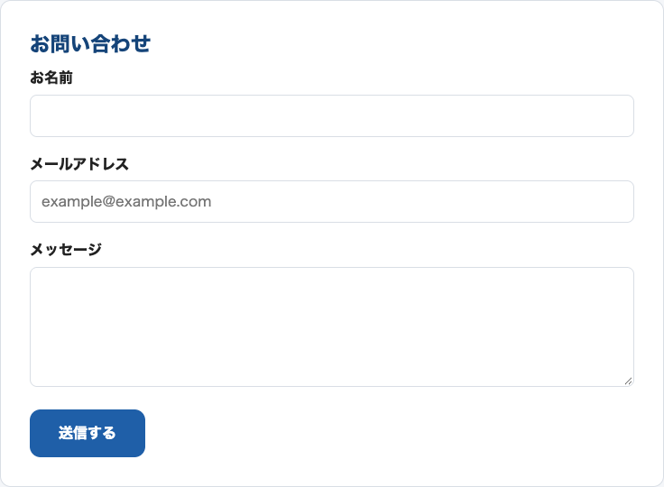

**入力チェックが働いた様子**（メールアドレスに `taro-at-example` と入力して送信ボタンを押した）

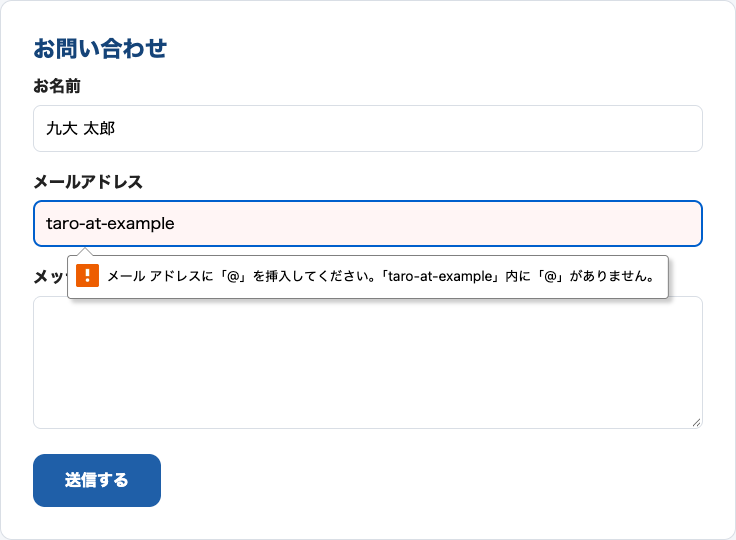

送信は中止され，ブラウザが「メール アドレスに「@」を挿入してください。」と表示した．空のまま送信した場合は「このフィールドを入力してください。」と表示される．

> このフォームは見た目と入力チェックの練習用で，送信先のサーバーはない（`action="#"`）．GitHub Pagesは静的なファイルを置くだけのサービスなので，POSTされたデータを受け取ることはできない．

---

## 25. テーブル

```html
<table>
  <caption>前期の時間割</caption>
  <thead>
    <tr>
      <th scope="col">時限</th>
      <th scope="col">月</th>
      <th scope="col">火</th>
      <th scope="col">水</th>
      <th scope="col">木</th>
      <th scope="col">金</th>
    </tr>
  </thead>
  <tbody>
    <tr>
      <th scope="row">1限</th>
      <td>線形代数</td>
      <td>英語</td>
      <td>—</td>
      <td>プログラミング演習</td>
      <td>統計学</td>
    </tr>
    <tr>
      <th scope="row">2限</th>
      <td>情報理論</td>
      <td>—</td>
      <td>データベース</td>
      <td>プログラミング演習</td>
      <td>—</td>
    </tr>
    <tr>
      <th scope="row">3限</th>
      <td>—</td>
      <td>ネットワーク</td>
      <td>ゼミ</td>
      <td>—</td>
      <td>Webサービス開発</td>
    </tr>
  </tbody>
</table>
```

| タグ | 役割 |
|---|---|
| `<table>` | 表全体 |
| `<caption>` | 表のタイトル |
| `<thead>` / `<tbody>` | 見出し行のまとまり／データ行のまとまり |
| `<tr>` | 1行 |
| `<th>` | 見出しセル．`scope="col"` は列の見出し（曜日），`scope="row"` は行の見出し（時限）であることを示し，読み上げソフトが「月曜・1限・線形代数」のように対応付けて読める． |
| `<td>` | データセル |

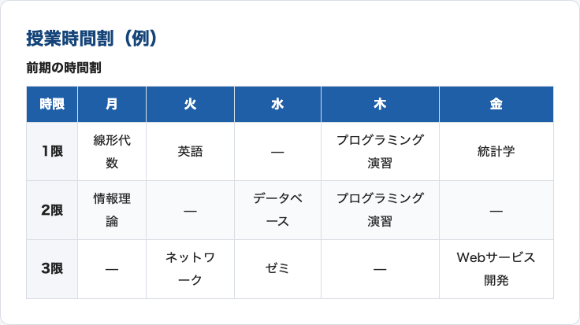

---

## 26. レイアウト（Grid＋Flexbox）

ページ全体の「本文＋サイドバー」の2カラムを **Grid**，ヘッダー内の横並びとアイコン＋文章の横並びを **Flexbox** で作った．

```css
/* ===== レイアウト（Grid / Flexbox） ===== */
.site-header {
  display: flex;
  justify-content: space-between;
  align-items: center;
  gap: var(--space-m);
}

.nav-list {
  display: flex;
  gap: var(--space-s);
}

.layout {
  display: grid;
  grid-template-columns: minmax(0, 1fr) 280px;
  grid-template-areas: "main sidebar";
  gap: var(--space-l);
  max-width: var(--max-width);
  margin: var(--space-l) auto;
  padding: 0 var(--space-m);
}

main {
  grid-area: main;
  display: grid;
  grid-template-columns: minmax(0, 1fr); /* 横に長い表があっても画面幅からはみ出さない */
  gap: var(--space-l);
  min-width: 0;
}

.sidebar {
  grid-area: sidebar;
  align-self: start;
  position: sticky;
  top: var(--space-m);
}

.profile {
  display: flex;
  align-items: center;
  gap: var(--space-l);
}
```

- `grid-template-columns: minmax(0, 1fr) 280px`：右のサイドバーは280px固定，残りの幅をすべて本文に使う．
- `grid-template-areas` で領域に名前を付けておくと，課題23のメディアクエリで `"main" "sidebar"` と書き換えるだけで縦並びに変えられる．
- `justify-content: space-between`：ヘッダーのタイトルを左端，メニューを右端に配置．
- `position: sticky`：スクロールしてもお知らせ欄が画面上部に残る．

**レイアウト後**（説明のため，各領域に色付きの点線枠を付けて撮影．赤＝`header`，緑＝`main`，橙＝`aside`，紫＝`footer`）

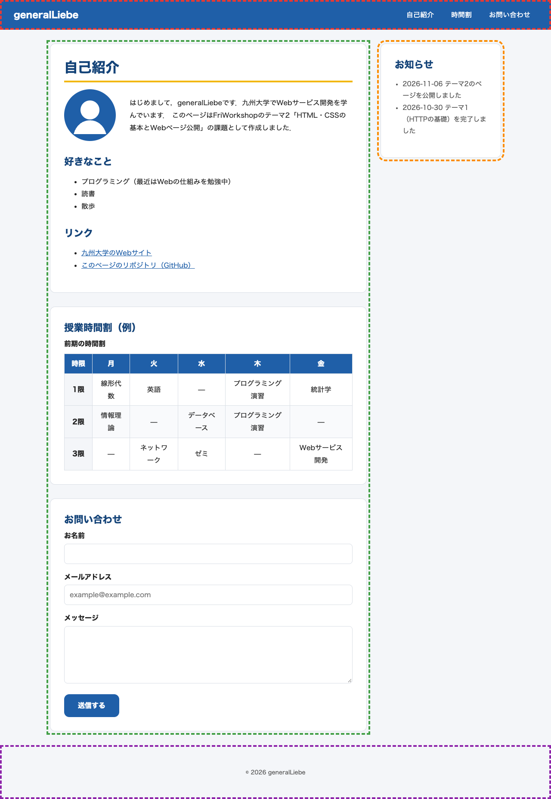

---

## 27. セマンティックHTMLとアクセシビリティ

### セマンティックタグによる骨組み

`<div>` だけで組まず，各部分の役割を表すタグを使った（中身は省略）．

```html
<body>
  <header class="site-header">
    <p class="site-title">generalLiebe</p>
    <nav aria-label="ページ内メニュー">
      <ul class="nav-list">
        <li><a href="#profile">自己紹介</a></li>
        <li><a href="#timetable">時間割</a></li>
        <li><a href="#contact">お問い合わせ</a></li>
      </ul>
    </nav>
  </header>

  <div class="layout">
    <main>
      <section id="profile" class="card">...</section>
      <section id="timetable" class="card">...</section>
      <section id="contact" class="card">...</section>
    </main>

    <aside class="sidebar card">...</aside>
  </div>

  <footer class="site-footer">
    <p><small>&copy; 2026 generalLiebe</small></p>
  </footer>
</body>
```

| タグ | 意味 |
|---|---|
| `<header>` | ページの先頭部分（サイト名・メニュー） |
| `<nav>` | 主要なナビゲーション．`aria-label` で何のメニューかを伝える |
| `<main>` | ページの主要な内容（1ページに1つ） |
| `<section>` | 見出しを持つ内容のまとまり |
| `<aside>` | 本文と関連は薄い補足情報（お知らせ） |
| `<footer>` | ページの末尾（著作権表示など） |

`.layout` の `<div>` はレイアウトのためだけの箱で意味を持たないので `<div>` のままにした．

セマンティックタグを使うと，読み上げソフトの利用者が「メイン部分へジャンプ」「ナビゲーションへジャンプ」のように移動できるほか，検索エンジンがページの構造を理解しやすくなる．

### Lighthouseでの計測と改善

デベロッパーツールの **Lighthouse** タブで，カテゴリ「Accessibility」を選んで計測した（ここではコマンドライン版 `lighthouse 13.6.0` で同じ計測を行った）．

```
$ npx lighthouse http://localhost:8765/ --only-categories=accessibility --output=html
```

**改善前：96点**

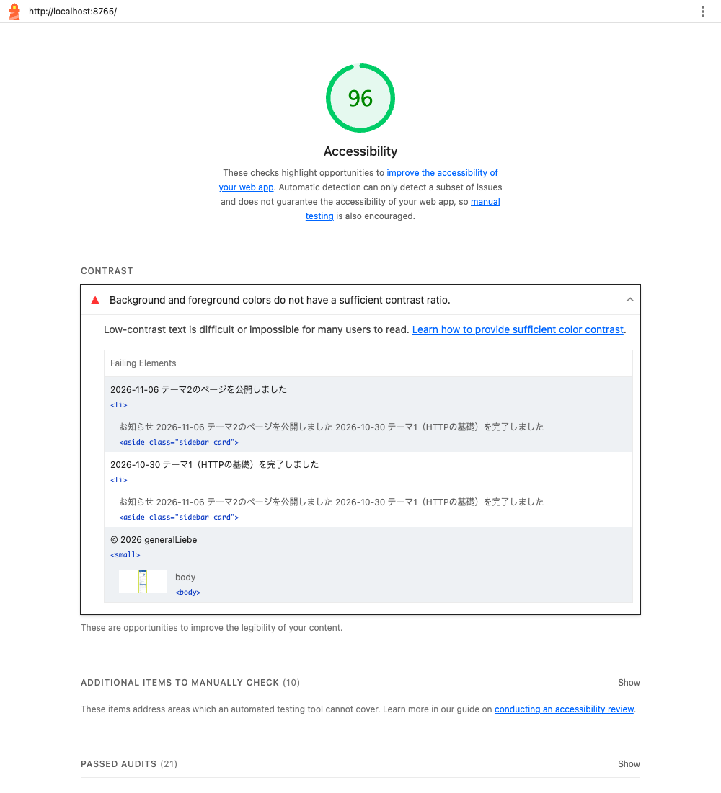

**改善後：100点**

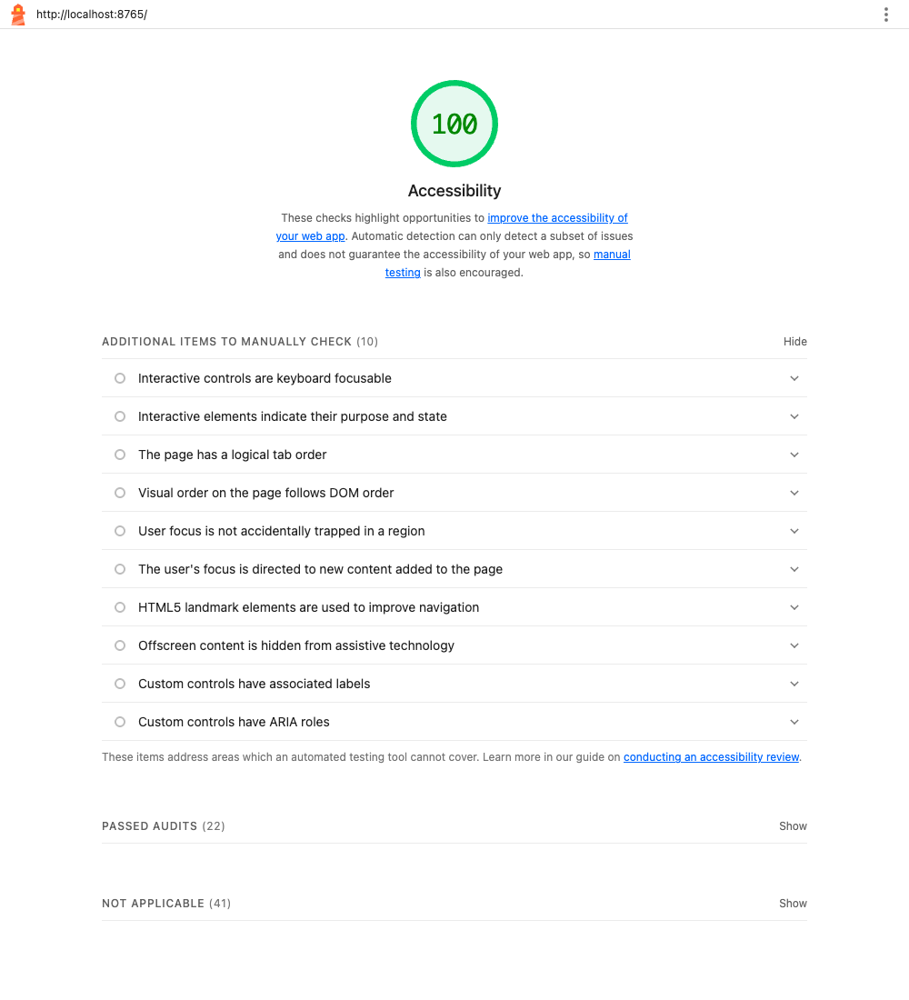

### 改善内容のメモ

| 項目 | 内容 |
|---|---|
| 指摘 | **Background and foreground colors do not have a sufficient contrast ratio**（背景色と文字色のコントラストが不十分） |
| 対象 | サイドバーの「お知らせ」の各行，フッターの著作権表示 |
| 原因 | 補足的な文字だからと薄いグレー `#9a9a9a` にしていた．コントラスト比は白背景で **2.81:1**，フッターの背景（`#f4f6f9`）で **2.59:1** で，基準（WCAG AA，通常の文字は **4.5:1** 以上）を満たしていなかった． |
| 改善 | CSS変数 `--text-sub-color` を `#595959` に変更（白背景で約7:1）． |
| 結果 | 96点 → **100点** |

```diff
-  --text-sub-color: #9a9a9a;
+  --text-sub-color: #595959; /* 改善前は #9a9a9a（コントラスト不足） */
```

色をCSS変数で管理していたので，1行の修正でサイドバーとフッターの両方を直せた．

> Lighthouseで100点でも，自動で検査できるのは一部の項目だけである．キーボードだけで操作できるか（`Tab` キーでリンクやボタンに移動できるか）などは人の手で確かめる必要がある．そのためボタンとナビゲーションには，`Tab` で選んだときにもホバー時と同じ見た目になるよう `:focus-visible` を指定している（課題28）．

---

## 28. CSSアニメーション

```css
/* ===== アニメーション ===== */
/* ページを開いたとき，カードが下からふわっと表示される */
@keyframes fade-in-up {
  from {
    opacity: 0;
    transform: translateY(16px);
  }
  to {
    opacity: 1;
    transform: translateY(0);
  }
}

.card {
  animation: fade-in-up 0.6s ease-out both;
}

/* ボタン：ホバーで色が変わり，少し浮き上がる */
.button {
  transition: background-color 0.3s ease, transform 0.3s ease, box-shadow 0.3s ease;
}

.button:hover,
.button:focus-visible {
  background-color: var(--accent-color);
  color: var(--text-color);
  transform: translateY(-3px);
  box-shadow: 0 6px 12px rgba(0, 0, 0, 0.2);
}

/* ナビゲーション：ホバーで背景色がつく */
.nav-list a {
  transition: background-color 0.3s ease;
}

.nav-list a:hover,
.nav-list a:focus-visible {
  background-color: var(--main-color-dark);
}

/* 動きを減らす設定の人にはアニメーションを止める */
@media (prefers-reduced-motion: reduce) {
  .card,
  .button,
  .nav-list a {
    animation: none;
    transition: none;
  }
}
```

| 方法 | 使った場所 | 説明 |
|---|---|---|
| `transition` | 送信ボタン，ナビゲーション | `:hover` などで状態が変わったとき，値の変化を0.3秒かけて滑らかにする．ボタンは青→黄色に変わり，3px浮き上がって影が付く． |
| `animation` + `@keyframes` | 各カード | ページを開いたときに自動で再生される．`from`（透明・16px下）から `to`（不透明・元の位置）へ0.6秒で変化する． |

- `transform` で動かすと，周りのレイアウトを計算し直さないので動きがなめらか．
- OSで「視差効果を減らす」を設定している人には，`prefers-reduced-motion` でアニメーションを止めている．

**動作中の様子**（ボタンにマウスを乗せて離す．見やすいよう1/10の速度で再生）

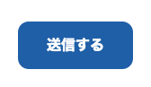

---

## 29. GitHub Pagesでの公開

### 手順

1. 公開するファイル（`index.html`・`style.css`・画像）を `docs/` フォルダにまとめ，`main` ブランチにpushした．
2. GitHubのリポジトリで **Settings → Pages** を開く．
3. 「Build and deployment」の **Source** を「Deploy from a branch」にし，**Branch** を `main`，フォルダを `/docs` にして **Save**．
4. 数十秒〜数分でデプロイが完了し，Pagesの画面に公開URLが表示される．

`docs/` を選んだのは，リポジトリ直下の `README.md`（課題の記録）と公開するサイトを分けるため．`docs/index.html` がトップページ（`/`）になる．

### 公開URL

- トップ（自己紹介ページ）：https://generalliebe.github.io/FriWorkshop/
- 課題20の最小ページ：https://generalliebe.github.io/FriWorkshop/minimal/

URLは `https://ユーザー名.github.io/リポジトリ名/` の形式になる．ユーザー名は小文字になる（`generalLiebe` → `generalliebe`）．

### 公開されたページ

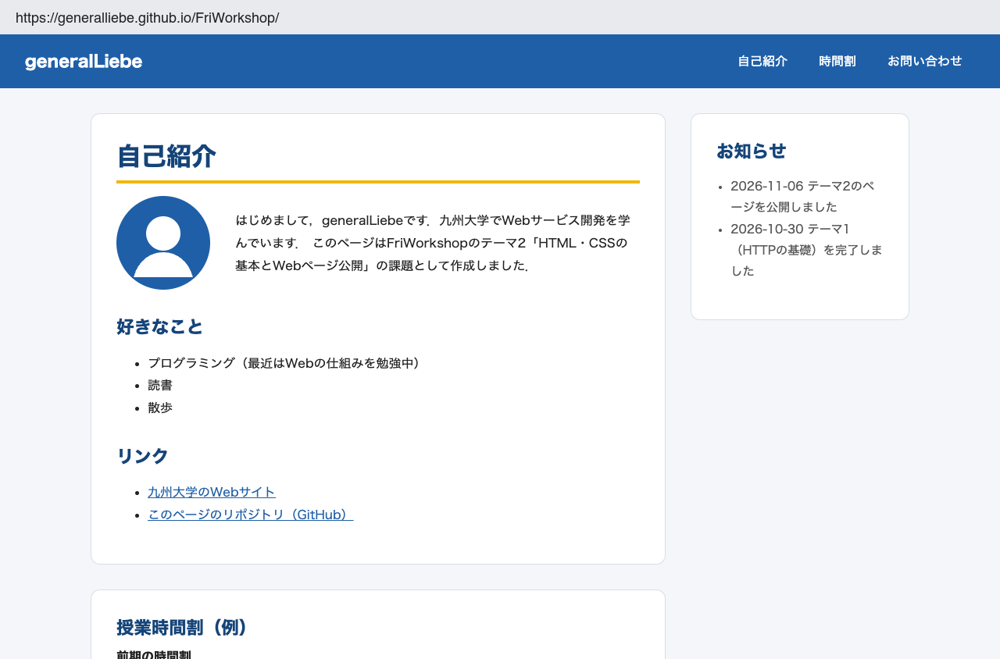
